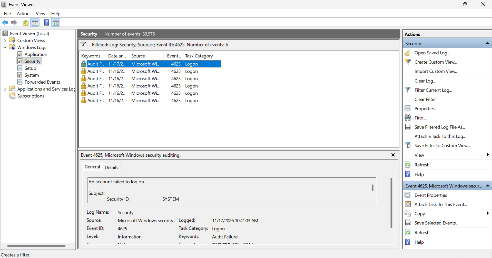
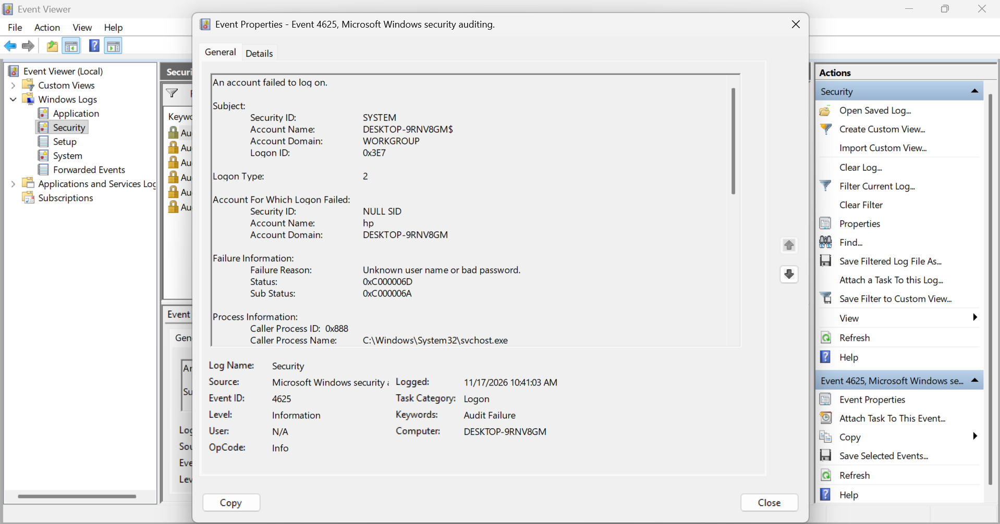
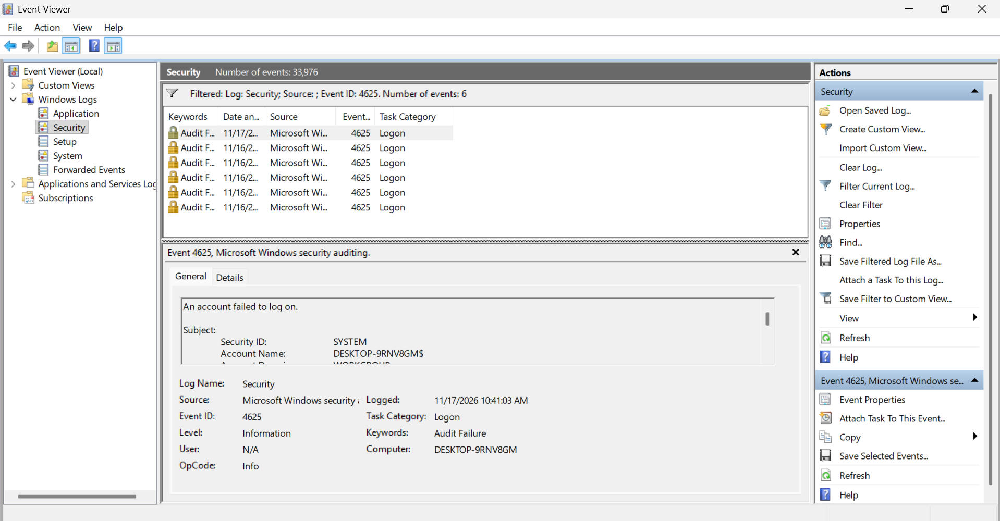
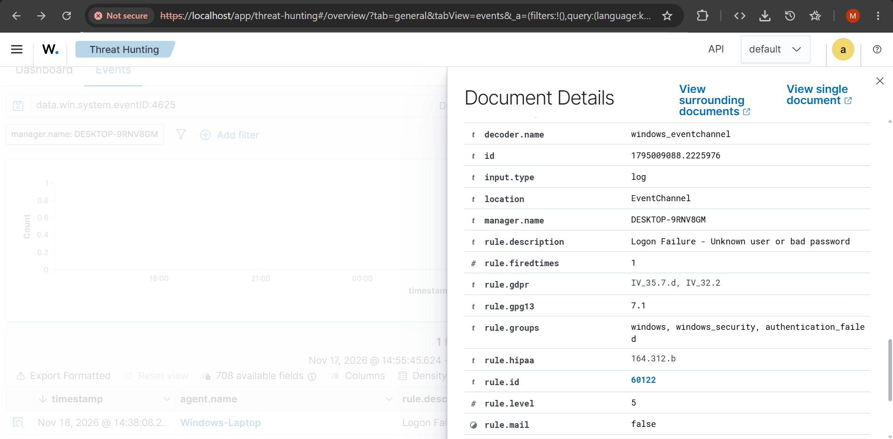
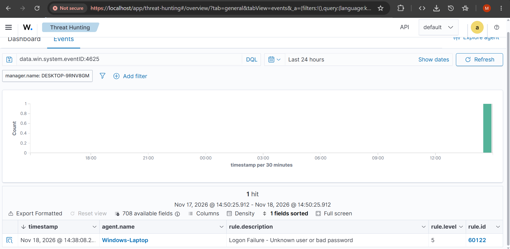
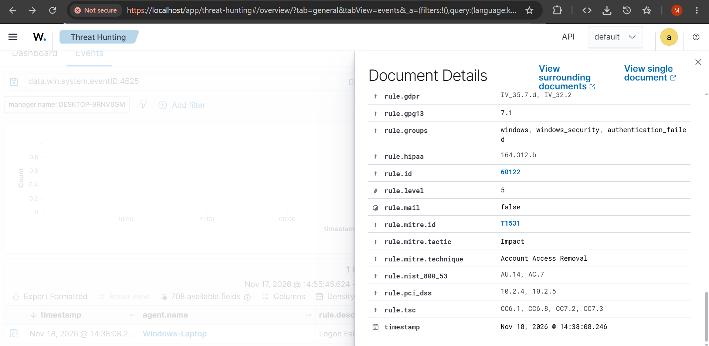

# SOC Practical Lab 01: Windows Failed Login Investigation

**Role:** Aspiring Tier 1 SOC Analyst  
**Project Type:** Blue Team / Security Monitoring  
**Status:** Initial Evidence Collection Completed – Wazuh Investigation Pending

## 1. Project Overview

This project involves investigating failed Windows authentication attempts using Windows Event Viewer and Wazuh.

The objective is to identify failed login events, analyse authentication evidence, investigate suspicious activity, and understand how a SIEM solution detects security events.

## 2. Investigation Environment

- Operating System: Windows
- Hostname: DESKTOP-9RNV8GM
- SIEM: Wazuh
- Log Source: Windows Security Event Logs
- Investigation Tool: Windows Event Viewer

## 3. Initial Evidence Collection

### Event Identification

- Event ID: 4625
- Event Description: An account failed to log on.
- Total Events Identified: 6
- Account Involved: hp
- Logon Type: 2 (Interactive)

### Authentication Failure Details

From one inspected event:

- Failure Reason: Unknown user name or bad password
- Status: 0xC000006D
- Sub Status: 0xC000006A
- Source Network Address: 127.0.0.1

### Preliminary Findings

Six failed authentication events were identified in the Windows Security log.

All six inspected events involved the local Windows account `hp`.

The inspected event showed an incorrect-password status and a localhost source address.

The available evidence does not establish malicious intent or an external attacker.

## 4. Investigation Screenshots

The following screenshots document the initial Windows failed login investigation.

### 4.1 Windows Security Log – Event ID 4625

The Windows Security log was filtered to identify six failed authentication events.

### 4.2 Failed Login Event Details

An individual Event ID 4625 was examined to identify the account involved and the type of authentication attempt.

### 4.3 Authentication Failure Information

The authentication failure details were examined to identify the reason for the unsuccessful login.

### Wazuh SIEM Investigation

**1. Wazuh Authentication Failure Evidence**

**2. Wazuh Alert Overview**

**3. Wazuh Alert Details**

## 5. Wazuh Investigation

**Status: Pending**

The next phase will involve:

- Verifying Windows agent connectivity.
- Searching for Event ID 4625 in Wazuh.
- Investigating relevant Wazuh alerts.
- Correlating Windows Security events with Wazuh.
- Analysing authentication failure patterns.

## 6. Skills Demonstrated

- Windows Event Viewer
- Windows Security Log Analysis
- Authentication Failure Investigation
- Event ID Analysis
- Basic Incident Documentation
- SIEM Investigation (Wazuh – pending)

## 7. Project Outcome

Initial Windows evidence collection has been completed.

The Wazuh investigation and final incident assessment will be documented as the project progresses.
